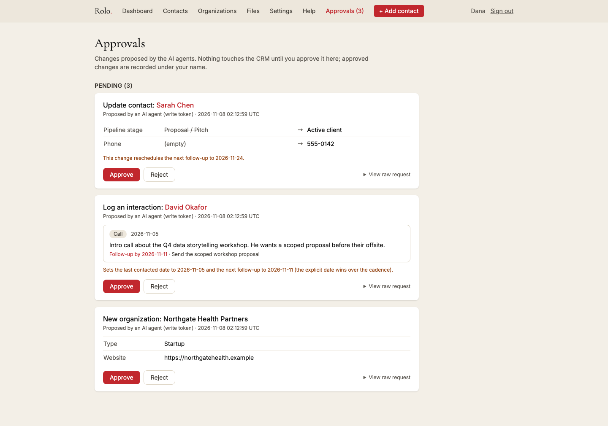
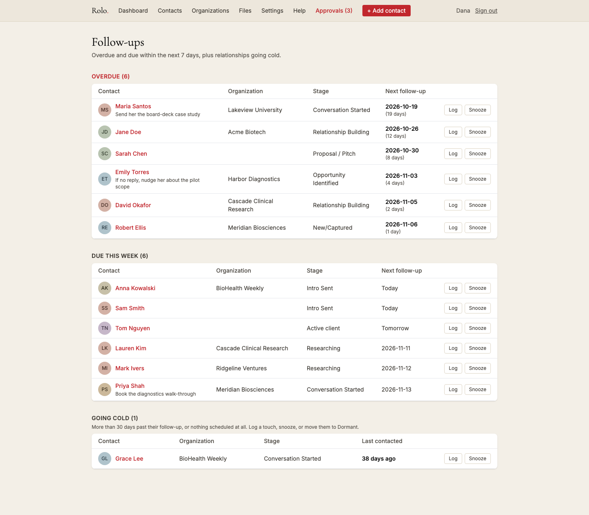
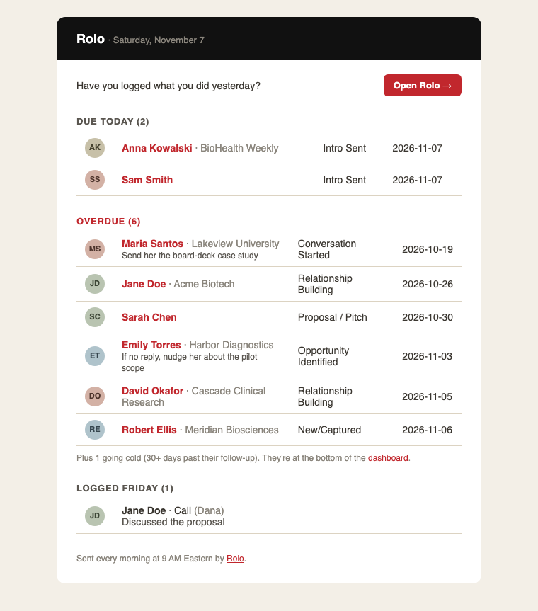
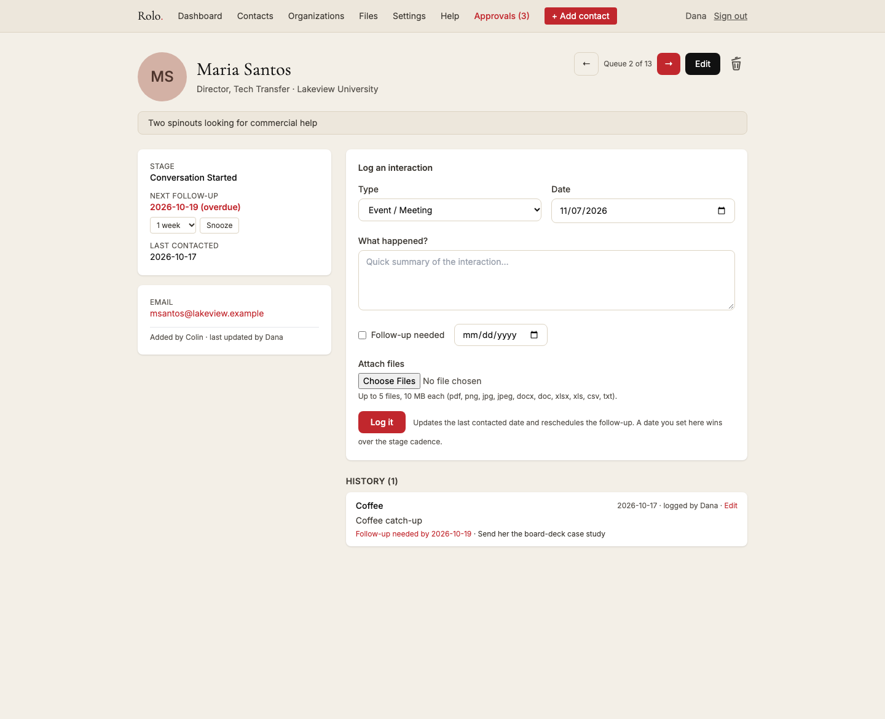
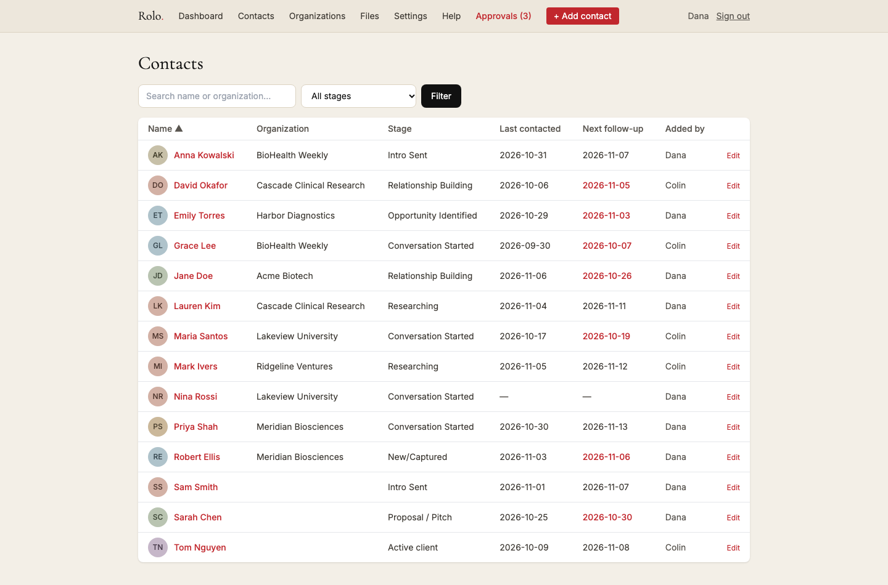
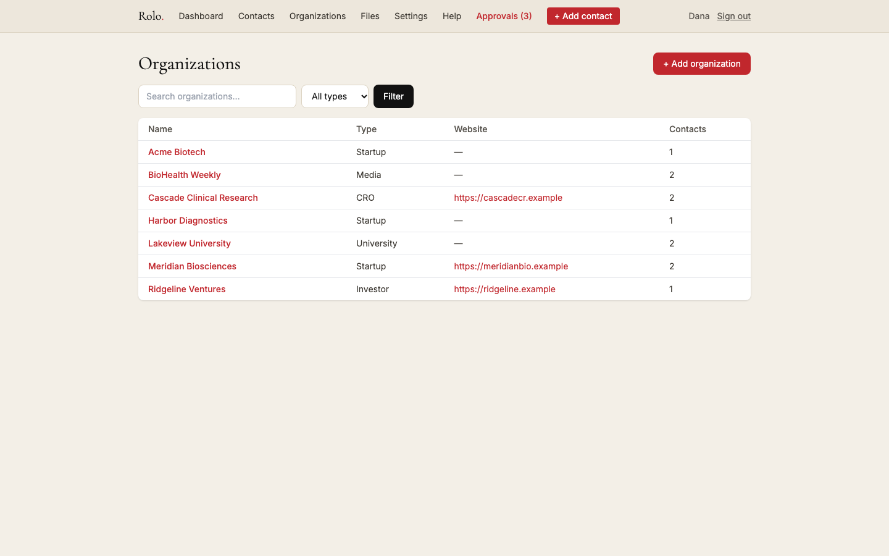
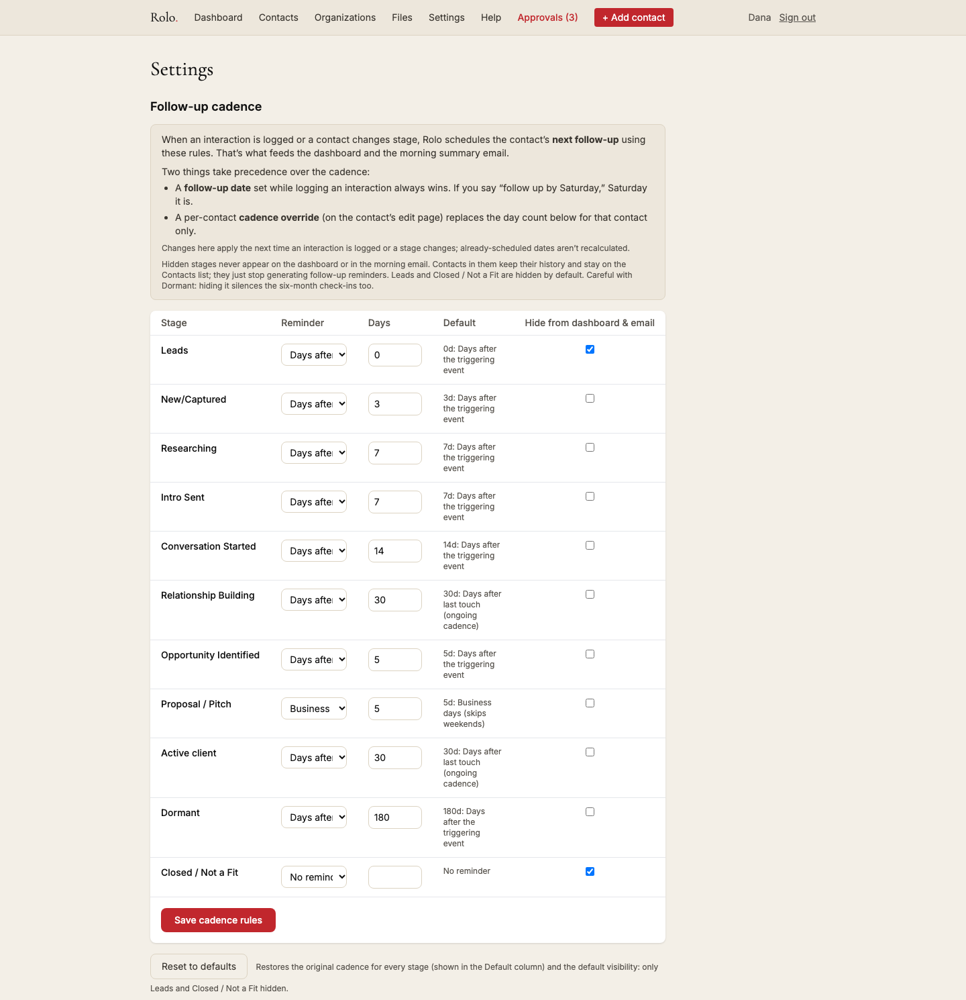

# Rolo

[](https://github.com/tuckercr/rolo-showcase/actions/workflows/ci.yml)

**The CRM that follows up with *you*.**

Most CRMs are databases that wait to be opened. Rolo has one job: never let
a relationship go cold. It decides who you owe a follow-up, then comes and
finds you: on the dashboard, in a morning email, and in Slack, where you can
clear your whole follow-up queue with a few taps without ever opening the
app.

It is not a demo. Rolo replaced a Coda spreadsheet at a real two-person
consultancy in July 2026 and has run their client pipeline in production
every day since.

## Why it's interesting

**🤖 It's an MCP server.** AI assistants like Claude plug straight into
Rolo over the Model Context Protocol: 13 tools, live reads, and a hard rule
enforced in the API layer rather than in agent instructions. Agents can
propose any change, but nothing an agent writes ever lands without a human
tapping Approve on a live before/after diff. You get AI leverage over your
pipeline with zero AI write access to your data.

**💬 It lives in Slack.** This is the feature the users actually rave
about. Every weekday at 5 PM the bot DMs you the contacts you owe, each
with Log / Open / Snooze / Skip buttons. Logging a call is a 10-second
modal. Skipping a contact swaps in the next one you haven't seen. Agent
proposals arrive as Approve / Reject buttons. A Monday DM catches contacts
quietly going cold, with an Edit button to retire the dead ones. Connect
your Google Calendar (read-only, per user) and the debrief also notices the
meetings you actually had with people in the CRM and offers to log them,
form prefilled with the meeting title. There's a `/rolo` command for
everything else: `log`, `snooze`, `who`, `today`, `week`, `overdue`,
`cold`, `debrief`. The bot even reports its own operations: deploys,
migrations, and crashes arrive as DMs, rate-limited so a crash loop can't
flood anyone.

And the part engineers tend to like: all of it runs on $5 shared hosting.
No resident process, no Socket Mode, no queue. Signed webhooks in,
`chat.postMessage` out, and a dumb external heartbeat where every scheduled
notice gates itself, so a double-fired cron is always a no-op.

**🧾 It's honest engineering.** Plain PHP 8.4 with strict types, MariaDB,
server-rendered HTML. No build step, no SPA, nothing to babysit. Deploys
are a file copy. 303 PHPUnit tests around the logic that actually breaks
(cadence math, the MCP protocol, the Slack flows, the dashboard SQL), PSR-12
enforced in CI, and Lighthouse scores of 96-100 performance and 100
accessibility across the main pages.

## Free to use

Rolo is Apache-2.0. Clone it, run it, ship it for your own team: it costs
nothing and there is no catch. This repo is a public snapshot of the
private production repo with internal docs and deploy scripts stripped and
the seed data genericized; everything you see here is the real code that
runs every day.

**Want help?** If you'd like Rolo deployed for your team, adapted to your
pipeline, or you want something like it built from scratch, I do that.
Email me at [colin@fangjet.com](mailto:colin@fangjet.com) and I'd be happy
to chat.

## Screenshots

**Approvals.** AI agents propose changes over MCP. A human sees a live
before/after diff and exactly what the change does to the follow-up schedule,
then approves or rejects. Agents never touch the CRM directly.



**Dashboard.** The Monday review: overdue, due this week, and a going-cold
section for anyone 30+ days past their follow-up or with nothing scheduled
at all. Each contact carries a note saying what actually needs doing, and
every row can log a touch or snooze inline without leaving the page.



<!-- TODO: Slack bot screenshots (debrief, log modal, cold alert) once the
     demo instance exists to take clean ones from. -->

**Daily email.** Every morning at 9 AM: due today first, then overdue, with
contact photos embedded as tiny inline attachments and initials for everyone
else.



**Contact detail.** Profile photo (click, drop, or paste an image straight
onto the avatar), full history, cadence snooze, and a one-line "human
detail" so you remember the person, not just the pipeline stage.



**Tasks.** One-off to-dos with a checkbox, kept deliberately separate from
the follow-up rhythm: a task can be about a contact, an organization, or
nothing at all, and ticking it never moves a follow-up date. They show up
on the dashboard, on contact and organization pages, in the morning email,
in Slack and over MCP.

**Mine and Everyone.** A small team shares one set of data, but each person
gets their own lens: contacts and tasks have an owner or are shared, and
the dashboard, the morning email and the Slack bot each show a person
their own plus the shared ones.

**Contacts.** Sortable, searchable, overdue flagged in red.



**Organizations.** Grouped view with per-org contact counts.



**Settings.** The cadence engine is data, not code: per-stage reminder rules
with one-click reset, per-stage dashboard visibility, and the Google
Calendar connection (read-only, per user, disconnect any time).



## The MCP integration

This is the part worth reading the code for. The CRM doubles as a tool server
for AI agents, with one rule enforced in the API layer instead of in agent
instructions: **reads are live, writes never land directly.**

- **REST API** (`/api/v1/*`). Per-person bearer tokens (an agent acts as its
  owner, and its proposals say whose agent it was) alongside shared
  read-only and read-write ones, all compared in constant time, cursor pagination, machine-readable errors, a
  120 req/min rate limit per token, and an audit row for every request.
- **MCP endpoint** (`/mcp`). The same tools over streamable HTTP: 18 tools
  with JSON schemas, read tools marked `readOnlyHint`, and a protocol core
  that's a pure, unit-tested class. Clients that can't send an Authorization
  header (claude.ai custom connectors) pass the token as a URL secret, which
  the audit trail redacts.
- **Every agent write is a proposal.** Bad payloads bounce immediately with a
  plain-English reason. Retries dedupe on idempotency keys. The review page
  shows each change as a live before/after diff against current data, plus a
  consequence line ("reschedules the next follow-up to Oct 23") computed by
  the same rules engine that will apply it. Approvals are attributed to the
  human; the proposing token stays on the audit trail.
- **Agents can't wreck the schedule.** Agent-logged activities don't count as
  a personal touch unless explicitly flagged, so bulk campaign logging can't
  clear the follow-up queue. A backdated touch approved out of order goes
  into history without dragging the schedule backwards.

## The Slack bot

Rolo comes to Slack instead of waiting to be opened
(`src/Controllers/SlackController.php`, `src/Services/Slack*.php`), and it
runs entirely on shared hosting: no resident process, no Socket Mode, just
signed webhooks in and `chat.postMessage` out.

- **The evening debrief.** Weekdays at 5 PM the bot DMs each configured
  person their overdue and due-today contacts (quoting the same split the
  dashboard shows), each with Log / Open / Snooze / Skip buttons. Log opens
  a Slack modal (type, date, note, follow-up date); submissions write
  through the same proposal pipeline as agents, so the scheduling rules
  live in exactly one place. Snoozes carry an Undo button. Skip actually
  does something: it swaps in the next contact that didn't fit the message,
  remembering what you've already skipped across taps.
- **Calendar suggestions.** A user who connects Google Calendar (read-only,
  from Settings) gets a "from your calendar today" section in their own
  debrief: meetings whose attendees match a contact's email, each with a
  Log button whose modal comes prefilled with the meeting title. Nothing is
  ever logged automatically, event details are never stored, and a calendar
  failure can never stop the debrief. The matcher is a pure function with
  its own test suite: it skips all-day events, declined events, meeting
  rooms, and anyone who already has an interaction logged that day.
- **Approvals as DMs.** Pending agent proposals arrive with Approve / Reject
  buttons: the review queue as a 5-second tap. Each proposal announces
  exactly once.
- **Tasks from Slack.** `/rolo task Send the proposal friday` captures a
  to-do in one line (the trailing word is parsed as the due date, and
  `for <name>:` attaches it to a contact); `/rolo tasks` lists your open
  ones with Done buttons and an Undo; the evening debrief closes with the
  tasks that are overdue or due today.
- **`/rolo` slash command.** `log <name>` and `snooze <name> [days]` for the
  moment a call ends; `who <name>` answers an ephemeral contact card;
  `today`, `week`, `overdue` and `cold` are the dashboard's lists as
  tappable rows (Log / Open / Snooze, plus Edit on the cold list to move a
  dead contact to Dormant or Closed from a modal); `debrief` sends the
  evening review on demand without silencing the scheduled one. DM the bot
  anything else and it politely explains it only speaks `/rolo`.
- **Scheduled nudges.** A Monday DM lists contacts that went cold within the
  week, computed statelessly by diffing today's going-cold set against last
  week's, with Open and Edit buttons per row. Reaching the Active client
  stage earns a small celebration DM.
- **Devops notices.** The bot reports on itself: deploys announce the
  revision, the migration endpoint announces applied migrations or a
  failure, the morning-email tick reports its own crash, and an uncaught
  500 anywhere DMs the ops user with the exception, deduped to one DM per
  hour so a crash loop can't flood Slack. A tiny Cloudflare Worker
  (`bin/cloudflare-worker.js`) watches from outside and DMs directly if the
  server stops answering entirely, because a dead server can't report its
  own death.
- **Security shape.** Inbound requests verify Slack's signing secret with a
  replay window; the tapping Slack account must map to an app user via an
  allowlist, and that user is recorded as the actor. Button taps from a
  signed-out phone resume at the exact contact after Google sign-in (with
  open-redirect protection on the resume path). The scheduler is a dumb
  external heartbeat hitting one CRON_SECRET-gated endpoint; every notice
  gates itself by hour, weekday and a dedupe row, so a double-fired cron
  (the DST trick) is always a no-op.

## What it does

- **Contacts and organizations.** Only a name is required to capture. A
  configurable pipeline (New/Captured through Active client), search,
  sortable columns, and a "human detail" field for the one memorable thing
  about each person.
- **Profile photos.** Click the avatar, drop a file on it, or paste an image
  from the clipboard. Server-side GD processing EXIF-rotates, center-crops,
  resizes to 400px and re-encodes, which also strips EXIF/GPS metadata;
  files live outside the web root and are served through a session-gated
  route. Contacts without a photo get a deterministic initials avatar, same
  color for the same name everywhere, including the email.
- **A follow-up rules engine.** Every logged interaction or stage change
  schedules the next touch from per-stage cadence rules stored in the
  database: fixed days, cadence from last touch, or business days. Rules are
  editable in a settings UI with one-click reset. An explicit "follow up by
  Saturday" always beats the cadence, and per-contact overrides beat the
  stage default. Each stage also has a visibility checkbox: hidden stages
  keep scheduling normally but stay off the dashboard and the daily email,
  so a bulk-imported Leads list never drowns out real follow-ups.
- **A dashboard that matches how the user actually works.** Overdue plus due
  this week, the real Monday review, and a going-cold section that catches
  what date-sorted lists miss: contacts 30+ days past their follow-up or
  with no follow-up scheduled at all. Logging and snoozing happen inline on
  the row, so clearing the morning list never means leaving the page.
  Overdue is always derived (`next_touch_date < today`), never stored, so it
  can't drift. Every surface (dashboard, email, Slack) quotes the same
  numbers because they share one query.
- **Google Calendar, read-only and opt-in.** Each user can connect their
  own calendar from Settings (offline OAuth against the same Google client
  as sign-in) and disconnect with one click, which deletes the stored
  credentials immediately. The only write Rolo ever makes is to its own
  database.
- **A daily summary email.** Every weekday morning at 9 AM Eastern: due
  today first (hidden entirely when empty), then overdue, then what was
  logged yesterday, with tiny inline photo thumbnails (CID attachments,
  since the photo route is auth-gated and Gmail strips data URIs) and
  initials fallbacks. A Cloudflare Worker cron hits a token-guarded
  endpoint, with a GitHub Actions schedule as backup; the app enforces
  local send time and once-per-day semantics, so DST is handled, retries
  are safe, and the redundant trigger is free.
- **An interaction history built for real use.** Edit in place with "edited
  by" attribution, editable dates, delete, file attachments (allowlisted by
  extension AND sniffed content type, stored outside the web root under
  random names, download-only), snooze that leaves an audit entry, and
  trash-can soft deletion with restore.
- **Follow-up notes.** Check "Follow-up needed" and a "What needs doing?"
  field appears. The note follows the contact onto the dashboard and into the
  daily email until the follow-up is logged, then clears itself.
- **Tags.** Freeform, comma-separated, case-insensitively deduped, filterable
  everywhere, auto-pruned when orphaned.
- **Two-person collaboration.** `created_by` / `updated_by` trails are stored
  and shown ("added by Dana, last updated by Colin"), so both users always
  know who touched what.
- **A public privacy page** (`/privacy`) for the OAuth consent screen,
  stating plainly how Google user data is used, including the Limited Use
  commitments.

There's also a built-in Help page covering connector setup for
non-technical users: what the AI integration is, how to connect Claude and
Superhuman, example prompts, and troubleshooting, written so the private
connector link is treated like a password.

## Architecture

Hand-rolled MVC, one front controller. Small enough to read in an afternoon:

```
public/index.php     front controller: session, auth gate, FastRoute dispatch,
                     last-resort crash handler that DMs ops (deduped hourly)
config/              bootstrap (.env via phpdotenv, UTC discipline), route table
src/Controllers/     request handling, no SQL, no HTML; Api/ holds the
                     stateless bearer-token REST + MCP controllers
src/Models/          PDO data access, one class per entity
src/Services/        ReminderService (the rules engine), ProposalService
                     (validate/queue/apply agent writes), McpProtocol,
                     the Slack services, GoogleCalendarService +
                     CalendarSuggestionService, DailySummaryService
src/Views/           PHP templates only; escaping helper on all dynamic output
src/Support/         Config, Database, Session, Csrf, Auth, Mailer, Dates, Migrator
database/migrations/ ordered .sql files, forward-only, tracked in a table
tests/               PHPUnit, focused on the logic most likely to break
```

Engineering choices I'd defend:

- **Auth is Google Sign-In only**, with an email allowlist. Google proves
  identity, the allowlist decides authorization. No passwords exist anywhere
  in the system. ID-token claims (`iss`, `aud`, `exp`, `email_verified`) are
  validated in pure, unit-tested functions.
- **The cadence engine is data, not code.** Changing "follow up with
  proposals after 5 business days" is a settings-page edit, not a deploy. The
  engine itself is a pure class with rules injected as arrays, and the
  weekend math and precedence order are fully unit-tested.
- **UTC discipline.** Storage and `CURRENT_TIMESTAMP` are UTC (the PDO
  session forces `time_zone = '+00:00'`). "Today" for humans is always
  computed in the business's timezone, so an evening entry never lands on
  tomorrow's date.
- **Security basics done properly.** Prepared statements everywhere, zero SQL
  concatenation, CSRF tokens on every state-changing form, escaping on all
  dynamic output, httponly/secure/SameSite cookies, session ID regeneration
  at login, open-redirect validation on the sign-in resume path, strict
  types in every file.
- **Soft deletes over hard deletes.** Trashing a contact hides it from every
  list, search, and reminder, but the full history stays restorable. There is
  deliberately no hard delete in the UI.
- **No-build deploys.** In the production repo `vendor/` is committed by
  design; deployment to shared hosting is a file mirror. A token-gated HTTP
  migration endpoint applies pending migrations on hosts where the database
  isn't reachable from outside.

## Stack

| Layer     | Choice                                              |
|-----------|-----------------------------------------------------|
| Backend   | PHP 8.4 (strict types), FastRoute, phpdotenv, PHPMailer |
| Database  | MariaDB 10.11 via PDO (native prepares)             |
| Frontend  | Server-rendered PHP views, Tailwind CSS via CDN     |
| Email     | SMTP (STARTTLS) or `mail()` fallback                |
| Slack     | Signed webhooks + Web API, no resident process      |
| Calendar  | Google Calendar API, read-only, per-user OAuth      |
| CI        | GitHub Actions: `php -l`, PHP_CodeSniffer (PSR-12), PHPUnit |
| Scheduler | Cloudflare Worker cron hitting a token-guarded endpoint (GitHub Actions as backup) |

## Running locally

```bash
git clone <repo> && cd rolo
composer install
cp .env.example .env                   # point DB_* at a local MariaDB
php bin/migrate.php                    # creates schema + seeds stages/cadence rules
php bin/seed_demo.php you@example.com  # optional: fictional data, dated relative to today
php -S 127.0.0.1:8000 -t public public/index.php
```

The seed gives a fresh install a living dashboard on day one: a fictional
consultancy with contacts overdue, due today, and going cold, weeks of
activity history, and three agent proposals waiting in the approval queue.
Pass your email so Google Sign-In recognizes you.

With `APP_ENV=local` the login page offers one-click dev sign-in, no Google
credentials needed. Tests and linting:

```bash
vendor/bin/phpunit
vendor/bin/phpcs
```

## Author

Built by [Colin Tucker](https://fangjet.com), a senior Android engineer. More projects at [fangjet.com/projects](https://fangjet.com/projects).

## License

Apache-2.0. See [LICENSE](LICENSE). Free for any use, commercial included.
And if you'd rather have it running for your team by Friday than read the
Apache license, [email me](mailto:colin@fangjet.com).
